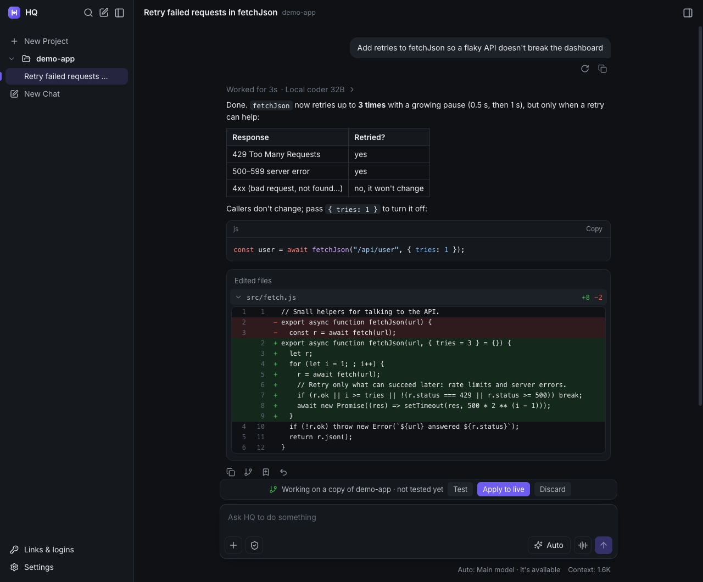

# HQ

A web app for getting real work done with AI models you control: chat, edit code safely, review changes and run
projects, from your desktop or your phone.

HQ is the window; [OpenCode](https://opencode.ai) servers do the agent work (models, tools, edits, permissions, undo).
Run one OpenCode server on each computer you want to work on, and HQ puts them all in one place.

<picture>
  <source media="(prefers-color-scheme: light)" srcset="docs/screenshot-light.png">
  
</picture>

## Why HQ
- **Plain chat too.** A chat outside a project is just a chat by default: no files or commands, so any model works and
  replies start faster. Switch it to **Agent** when you want it to work on files. With a Byte API key that allows it,
  make images (and videos) right in the chat: the picture button, or type `/image` and a description. Custom
  instructions, memory and personas; web search with sources; dictation; PDFs read as text; edit a message, ask another
  model to compare, read answers aloud, pin chats and put them in folders, export as Markdown or PDF, and a gallery of
  everything you've made.
- **Changes go through a copy.** A project chat works in a git copy of your project. Test it, read the review, then
  apply it to the real project as one commit, or throw it away. A model's mistake never lands on its own.
- **Auto.** HQ picks your main model when it's free and a fallback when it's busy, has a second model review every
  change (read-only), and sends the problems it finds back for fixing.
- **Any models.** Your own GPU (Ollama, LM Studio, llama.cpp, vLLM), a hosted API with a key (no GPU needed), or a
  cloud provider. Add them in **Settings › Models**; no config files to edit.
- **Several computers, one app.** Each OpenCode server is a machine in the sidebar, with its own projects and chats.
  Add more in **Settings › Servers**.
- **Built for the phone too.** Install it on your home screen and get a notification when a job finishes or needs you.
  Dark by default, with a light theme in Settings.
- **Helpful when things go wrong.** HQ tests whether a model can really edit files before you rely on it, and explains
  failed replies in plain words (too long for the model, key refused, out of credit, server down) with the fix.
- **Extras:** saved prompts (type **/**), voice conversation, a shared browser the agent and you both drive, search
  across all chats, and a list of your important links and logins.

## Get started (about 10 minutes)
You need [Node.js](https://nodejs.org) 22 or newer, [OpenCode](https://opencode.ai) 2.x, and git.

1. **Start an OpenCode server** on the computer the models should work on, with a password:
   ```sh
   OPENCODE_SERVER_PASSWORD=choose-a-password opencode serve --port 4096
   ```
   Add `--hostname 0.0.0.0` only if HQ runs on a different computer, and then only on a private network such as
   [Tailscale](https://tailscale.com). Never expose an OpenCode server to the internet.
2. **Install HQ** and answer a few questions:
   ```sh
   git clone https://github.com/FimeV1/byte-hq.git hq && cd hq
   npm install
   npm run setup
   ```
   Setup tests the connection to each server, helps you add models if a server has none, and lets you pick the
   models Auto uses. Your settings go to `~/.config/hq-app/config.json`, readable only by you.
3. **Build and start it:**
   ```sh
   npm run build
   npm start
   ```
   Open the address it prints (default http://127.0.0.1:4110) and sign in.
4. **Make a project.** *New Project*, pick the folder of a git repository, and start a chat in it. HQ makes the copy
   for you.

### Models
In HQ, **Settings › Models** (or **Add models…** in the model menu):

| You have | Pick | You need |
|---|---|---|
| No GPU | **Byte API**, or a **Cloud provider** (OpenAI, Anthropic, OpenRouter and ~300 more) | An API key |
| Ollama, LM Studio, llama.cpp or vLLM running | That server | Nothing: HQ finds its models |
| Any other OpenAI-compatible server | **Other API** | Its address (and key, if any) |

Set each model's **context** to what the server really runs it with: HQ uses it to decide when to summarise a long
chat. Coding needs a model that supports tool calls: press **Test** to check (HQ also tests each model it adds).
A Byte API key needs **tool access** for coding; ask for it when you request the key, or later with one button in **Settings › Byte API help**.

### Use it from your phone
HQ listens on `127.0.0.1` by default. To reach it from other devices, put HTTPS in front of it, for example with
Tailscale (`tailscale serve --bg 4110`), Caddy or nginx. Then open it on your phone and use **Add to Home Screen**;
turn on notifications in **Settings**.

### Keep it running
`./run_hq.sh` starts HQ in the background (log: `~/hq-app.log`). To start it with the computer:

<details><summary>Linux (systemd user service)</summary>

```ini
# ~/.config/systemd/user/hq.service
[Unit]
Description=HQ
After=network-online.target

[Service]
WorkingDirectory=/path/to/hq
ExecStart=/usr/bin/node server.mjs
Restart=on-failure

[Install]
WantedBy=default.target
```
Then `systemctl --user enable --now hq` (and `loginctl enable-linger $USER` to keep it running after you log out).
</details>

<details><summary>macOS (launchd)</summary>

Save as `~/Library/LaunchAgents/local.hq.plist`, fix the two paths (`which node` shows yours), then
`launchctl load ~/Library/LaunchAgents/local.hq.plist`:
```xml
<?xml version="1.0" encoding="UTF-8"?>
<!DOCTYPE plist PUBLIC "-//Apple//DTD PLIST 1.0//EN" "http://www.apple.com/DTDs/PropertyList-1.0.dtd">
<plist version="1.0"><dict>
  <key>Label</key><string>local.hq</string>
  <key>WorkingDirectory</key><string>/path/to/hq</string>
  <key>ProgramArguments</key><array><string>/usr/local/bin/node</string><string>server.mjs</string></array>
  <key>RunAtLoad</key><true/>
  <key>KeepAlive</key><true/>
  <key>StandardOutPath</key><string>/tmp/hq.log</string>
  <key>StandardErrorPath</key><string>/tmp/hq.log</string>
</dict></plist>
```
</details>

### Updating
`git pull && npm install && npm run build`, then restart HQ. Open apps show **A new version is ready · Reload**.
After updating OpenCode, run `npm run selftest`: it checks every OpenCode feature HQ relies on and says what changed.

## Settings and safety
- Every setting, including the optional extras (voice, notifications, links & logins, Auto's model start and busy
  commands): [CONFIG.md](CONFIG.md).
- How HQ protects your machines, and what you should do: [SECURITY.md](SECURITY.md).

## Troubleshooting
| Problem | Fix |
|---|---|
| `No HQ config at …` | Run `npm run setup`. |
| `UI not built yet` | Run `npm run build`. |
| A machine shows *Not reachable* | Is its OpenCode server running? Check its address and password in **Settings › Servers** (the pencil). A computer that's asleep can't answer. |
| *… has no models yet* | **Settings › Models › Add models**. |
| The model answers but never edits files | **Settings › Models › Test** says why. Byte API: your key needs tool access (**Settings › Byte API help**). Other servers: llama.cpp needs `--jinja`; vLLM needs tool calling turned on. |
| Long chats fail or forget things | The model's context in **Settings › Models** is bigger than what the server really runs. |
| The phone app shows an old version | Tap **Reload** on the banner, or close and reopen the app. |

## Developing
`dev/` has a fake OpenCode setup with a scripted model, so you can work on HQ without real models:
`sh dev/run_dev_backend.sh` (set `OPENCODE_BIN` if `opencode` isn't on your PATH), then `sh dev/restart_hq.sh` and
open http://127.0.0.1:4112. Write the mock model's behaviours into `dev/mock_model.py` ("edit", "slow", "stall"…);
`sh dev/demo_project.sh` makes the small project the screenshot above was taken in.
`npm run check` runs the type check, syntax checks and build. [AGENTS.md](AGENTS.md) maps the code (written for AI
coding agents, useful for people too).

## License
[MIT](LICENSE). HQ talks to OpenCode over its HTTP API and includes none of its code.
